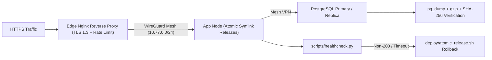

# HA Infrastructure Blueprint

Sanitized infrastructure-as-code blueprint and operational scripts for zero-downtime application releases, WireGuard mesh networking, Nginx reverse proxy hardening, PostgreSQL backup verification, and automated rollback.

## Reference Topology



## Components

- `nginx/conf.d/app.conf.template` — TLS termination, rate limiting, security headers (`HSTS`, `nosniff`, `DENY`), and `/healthz` proxy endpoint
- `wireguard/mesh-node.conf.example` — Private WireGuard mesh template isolating internal node-to-node traffic
- `scripts/wg_audit.py` — Automated audit rejecting non-private addresses, missing keepalives, or accidental `0.0.0.0/0` routes on internal mesh interfaces
- `deploy/atomic_release.sh` — Atomic symlink switch with automatic rollback to the previous release if post-switch healthcheck fails
- `backup/pg_backup_verify.sh` — Compressed PostgreSQL backup with `gzip -t`, `sha256sum -c` verification, and retention pruning
- `scripts/healthcheck.py` — Fail-closed HTTP readiness probe outputting structured JSON
- `tests/test_infra_blueprint.py` — Automated test suite verifying WireGuard audit rules, HTTP healthchecks, Nginx security rules, and POSIX symlink rollback

## Verification

```bash
bash -n deploy/atomic_release.sh backup/pg_backup_verify.sh
python scripts/wg_audit.py wireguard/mesh-node.conf.example
python -m unittest discover -s tests -v
```
